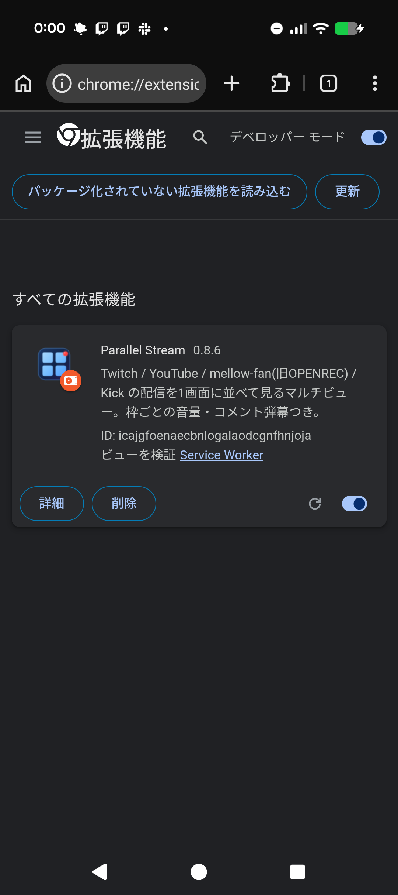
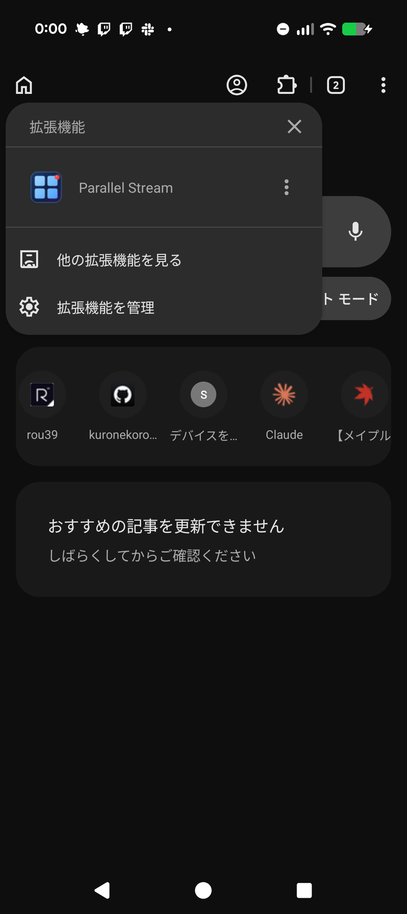

# BEX

Chrome 拡張機能が動く Android ブラウザ。Chromium を改造し、PC 版の拡張機能を
スマートフォンで使えるようにしたものです。

| 拡張機能の管理 | 拡張機能メニュー |
|---|---|
|  |  |

## できること

- 任意の Manifest V3 拡張機能が動く（提供元が用意した限定リストではない）
- Chrome ウェブストアから検索・インストール・削除ができる
- 未パッケージ拡張機能をフォルダから読み込める（自作拡張をスマホで直接テストできる）
- 拡張機能 UI のモバイル対応（ツールバーアイコン、BottomSheet ポップアップ、
  サイドパネル、omnibox キーワード）

動作確認済み: uBlock Origin Lite（広告ブロック）、自作拡張数種。

## 使う

[リリース](../../releases)から APK をダウンロードし、「提供元不明のアプリ」を
許可してインストールしてください。パッケージ名は `com.rou39.bex` で、
Chrome / Chromium とは別のアプリとして共存します。

### 更新を受け取る

Play ストア経由ではないため自動更新はされません。
[Obtainium](https://github.com/ImranR98/Obtainium) にこのリポジトリの URL を
登録しておくと、新しいリリースを検知して更新できます。
詳細は [docs/updates.md](docs/updates.md) を参照してください。

> [!WARNING]
> **実験的なビルドです。常用は推奨しません。**
> セキュリティ更新は保証されません（Chromium は約4週間ごとに脆弱性修正を出しますが、
> このビルドが同じ速度で追随することはありません）。パスワードや決済情報など、
> 機微な情報の入力には使わないでください。

## ビルドする

```bash
./scripts/setup.sh          # Chromium ソース取得と環境構築
./scripts/apply-patches.sh  # パッチ適用
./scripts/build.sh --setup  # ビルド設定
./scripts/build.sh          # ビルド
```

詳細は [docs/build-environment.md](docs/build-environment.md)、
配布用ビルドの手順は [docs/release.md](docs/release.md) を参照してください。

## 仕組み

Chromium 本体に 28 本のパッチを当てています。一覧は
[patches/README.md](patches/README.md)、実装の詳細と検証結果は
[docs/](docs/) 以下にあります。

開発の過程で、Chromium の desktop-android 実装（Google が開発中の実験的構成）に
起因するバグをいくつか特定して修正しました。詳細は
[docs/upstream-issues.md](docs/upstream-issues.md) にまとめてあります。

## ライセンス

本リポジトリのパッチとスクリプトは [BSD-3-Clause](LICENSE) です。ベースとなる Chromium も
BSD-3-Clause ですが、**同梱している FFmpeg は LGPL v2.1+** であり、バイナリを
配布する場合はそのソースの入手可能性を確保する必要があります。third-party の
ライセンス表記はアプリ内の `chrome://credits` から確認できます。

## ドキュメント

| | |
|---|---|
| [vision.md](docs/vision.md) | プロジェクトの当初構想 |
| [build-environment.md](docs/build-environment.md) | ビルド環境の構築 |
| [release.md](docs/release.md) | 配布用ビルドの作り方 |
| [updates.md](docs/updates.md) | バージョン管理と更新の届け方 |
| [upstream-issues.md](docs/upstream-issues.md) | 特定した上流バグと修正 |
| [patches/README.md](patches/README.md) | パッチ一覧 |
| [phase1-results.md](docs/phase1-results.md) / [phase2-results.md](docs/phase2-results.md) | 基盤・API の検証結果 |
| [phase3-patches.md](docs/phase3-patches.md) / [phase3-ui-styles.md](docs/phase3-ui-styles.md) | UI 実装の詳細と検証結果 |
| [smoke-test.md](docs/smoke-test.md) | 実機テスト手順 |
